 

About Me

I'm an AI engineer who builds practical **Generative AI and LLM applications**, taking them from prototype to production. My work covers **RAG systems** that ground answers in real documents, **AI agents** that automate multi-step workflows, **OCR and document intelligence**, **NLP**, and **machine learning / deep learning** models.

I follow a simple loop: **build** a focused solution, **evaluate** it on real data, **deploy** it through reproducible pipelines, and **monitor** it in production.

 

Tech Stack

